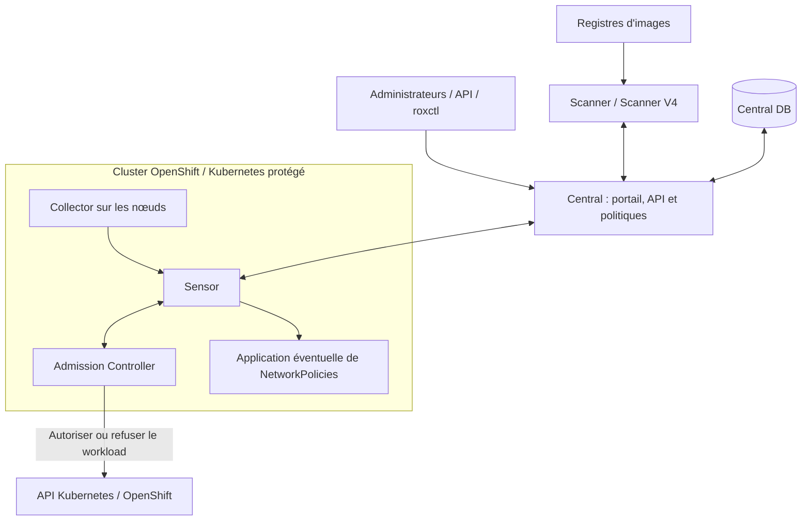
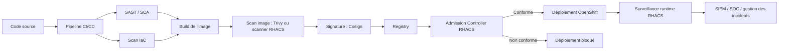

# Red Hat Advanced Cluster Security for Kubernetes (RHACS / ACS)

## 1. Présentation générale

**Red Hat Advanced Cluster Security for Kubernetes (RHACS)**, souvent appelé **ACS**, est une plateforme de sécurité dédiée aux environnements Kubernetes et OpenShift. Elle sécurise les applications conteneurisées tout au long de leur cycle de vie :

- **Build** : identifier les vulnérabilités et les risques dans les images avant leur déploiement.
- **Deploy** : contrôler les configurations et empêcher le déploiement de workloads qui enfreignent les politiques.
- **Runtime** : surveiller les activités des conteneurs et détecter des comportements suspects après leur mise en production.

RHACS ne se limite donc pas à scanner les images. Il met en relation les vulnérabilités, les configurations Kubernetes, les déploiements, les communications réseau et les événements d'exécution afin d'aider les équipes à prioriser les risques.


> La documentation Red Hat contient le schéma d'architecture officiel et les détails des composants. L'architecture exacte peut varier selon la version de RHACS et le mode de déploiement.

## 2. Architecture et composants

RHACS repose sur deux ensembles de services :

1. **Central Services** : généralement installés sur un cluster central. Ils fournissent le portail, les API, la gestion des politiques, la persistance des données et les fonctions d'analyse des images.
2. **Secured Cluster Services** : installés sur chaque cluster OpenShift/Kubernetes à protéger. Ils observent le cluster, collectent les événements et appliquent les contrôles de sécurité.

### 2.1 Central Services

| Composant | Rôle |
|---|---|
| **Central** | Cœur applicatif de RHACS : portail web, API, gestion des politiques, coordination avec les clusters protégés et présentation des risques. |
| **Central DB** | Stockage persistant des données RHACS : inventaire, configurations, résultats d'analyse, alertes et informations de conformité. |
| **Scanner / Scanner V4** | Analyse les images de conteneurs, leurs couches, les paquets système et les dépendances afin d'identifier les vulnérabilités connues (CVE). Selon la version et la configuration, l'architecture de scan peut s'appuyer sur Scanner V4 (Indexer et Matcher) ou sur le scanner StackRox. |

### 2.2 Secured Cluster Services

| Composant | Rôle |
|---|---|
| **Sensor** | Observe l'état du cluster via l'API Kubernetes/OpenShift, reçoit les événements du Collector, applique la logique des politiques et échange avec Central. Il peut notamment aider à appliquer des NetworkPolicies lorsque cette fonction est configurée. |
| **Collector** | Surveille les activités des conteneurs et des nœuds : événements runtime, processus et informations réseau. Il transmet les événements au Sensor. |
| **Admission Controller** | Intervient au moment de la création des workloads. Il peut refuser un déploiement qui viole une politique RHACS configurée en mode enforcement. |
| **Scanner-slim** | Composant de scan léger déployé dans certains environnements protégés, notamment pour faciliter l'analyse d'images dans des registres locaux ou intégrés. Sa présence dépend de la version et de la configuration. |

### 2.3 Vue simplifiée des échanges



**À retenir :** Central orchestre et consolide les informations ; Sensor observe et coordonne les actions dans le cluster ; Collector remonte les événements runtime ; Admission Controller applique les politiques au moment du déploiement.

---

## 3. Les six domaines fonctionnels de RHACS

### Domaine 1 — Vulnerability Management (gestion des vulnérabilités)

**Objectif :** identifier, qualifier et prioriser les vulnérabilités présentes dans les images de conteneurs, les composants logiciels et, selon les capacités activées, les éléments de l'infrastructure Kubernetes/OpenShift.

RHACS analyse les images et rapproche les paquets détectés des bases de vulnérabilités connues (CVE). Il permet notamment de :

- repérer les CVE présentes dans les images ;
- visualiser la sévérité des vulnérabilités (Critical, High, Medium, Low) ;
- identifier les images et les workloads concernés ;
- relier une vulnérabilité à un déploiement, un namespace ou un cluster ;
- prioriser les corrections en fonction de l'exposition et du contexte d'exécution ;
- suivre les vulnérabilités dans le temps et vérifier qu'une nouvelle image corrige bien le problème.

**Exemple concret :** une image applicative contient une version vulnérable d'OpenSSL. RHACS identifie la CVE, indique les images et déploiements concernés et aide à prioriser la mise à jour de l'image de base ou du paquet.

**À distinguer :** Trivy est un scanner spécialisé qui peut être utilisé dans une pipeline CI pour analyser une image ou du code IaC. RHACS apporte une vision centralisée et contextualisée des vulnérabilités dans les clusters, en reliant les résultats aux workloads et aux politiques. Un scan ne corrige pas la vulnérabilité : il faut mettre à jour l'image ou le composant, reconstruire, tester et redéployer.

### Domaine 2 — Configuration Management (gestion des configurations)

**Objectif :** détecter les mauvaises configurations Kubernetes/OpenShift et les écarts par rapport aux bonnes pratiques de sécurité.

RHACS examine notamment les configurations des workloads et des ressources Kubernetes. Les contrôles peuvent porter sur :

- les conteneurs exécutés en mode `privileged` ;
- l'exécution en tant que `root` ;
- les capacités Linux excessives (`CAP_SYS_ADMIN`, par exemple) ;
- l'utilisation du système de fichiers racine en écriture ;
- les montages sensibles de volumes ;
- les paramètres de sécurité des pods et conteneurs ;
- les permissions RBAC trop larges ;
- les secrets ou configurations sensibles exposés de manière inappropriée ;
- les configurations de namespaces et de workloads.

**Exemple concret :** un Deployment démarre un conteneur avec `privileged: true`, alors que l'application n'en a pas besoin. RHACS détecte cette configuration à risque et peut générer une alerte ou empêcher le déploiement si une politique d'admission correspondante est configurée en mode enforcement.

Exemple de configuration plus restrictive :

```yaml
securityContext:
  runAsNonRoot: true
  allowPrivilegeEscalation: false
  readOnlyRootFilesystem: true
  capabilities:
    drop:
      - ALL
```

**Lien avec OpenShift :** les **Security Context Constraints (SCC)** contrôlent les permissions et les contextes de sécurité autorisés pour les pods. RHACS permet de détecter des configurations à risque et de les contrôler au moyen de ses politiques ; il ne remplace pas le mécanisme SCC natif d'OpenShift.

### Domaine 3 — Compliance (conformité)

**Objectif :** mesurer et documenter le niveau de conformité des clusters et workloads par rapport à des référentiels de sécurité.

Selon la version, les profils disponibles et la configuration, RHACS permet de suivre des contrôles associés à des référentiels tels que :

- CIS Kubernetes Benchmark ;
- contrôles de sécurité Kubernetes et OpenShift ;
- NIST ;
- PCI DSS ;
- autres standards ou profils pris en charge par la version installée.

Les fonctions de conformité servent à :

- exécuter ou consulter des évaluations de conformité ;
- identifier les contrôles en échec ;
- visualiser les écarts par cluster ou par contrôle ;
- produire des éléments de preuve et des rapports ;
- suivre la remédiation des non-conformités.

**Exemple concret :** un contrôle exige que les workloads ne soient pas exécutés avec des privilèges excessifs. L'évaluation fait ressortir les workloads concernés. L'équipe sécurité ouvre une action de remédiation, fait corriger les manifests ou les chart Helm, puis relance le contrôle.

**Attention à la distinction :** le **Compliance Operator** d'OpenShift est un opérateur distinct, dédié à l'évaluation de conformité de la plateforme selon des profils pris en charge. Les fonctions Compliance de RHACS et le Compliance Operator peuvent être complémentaires, mais ce ne sont pas le même produit.

### Domaine 4 — Network Segmentation (segmentation réseau)

**Objectif :** comprendre les communications entre les workloads et réduire les flux réseau au strict nécessaire.

RHACS peut observer les communications réseau entre les composants applicatifs et présenter une représentation des flux. Cette visibilité permet de :

- repérer les communications entre namespaces et workloads ;
- identifier des flux inattendus ou trop permissifs ;
- comprendre les dépendances réseau d'une application ;
- aider à définir des règles de segmentation ;
- générer ou faciliter la mise en place de Kubernetes NetworkPolicies, selon la configuration et les droits accordés.

**Exemple concret :** une application dans le namespace `frontend` communique avec un service dans `backend`. Le graphe réseau permet de visualiser ce flux. Après validation par les équipes applicatives, une politique réseau peut autoriser uniquement le trafic nécessaire et refuser les autres communications.

Exemple de politique restrictive (à adapter aux labels et ports réels) :

```yaml
apiVersion: networking.k8s.io/v1
kind: NetworkPolicy
metadata:
  name: allow-frontend-to-backend
  namespace: backend
spec:
  podSelector:
    matchLabels:
      app: backend
  policyTypes:
    - Ingress
  ingress:
    - from:
        - namespaceSelector:
            matchLabels:
              kubernetes.io/metadata.name: frontend
      ports:
        - protocol: TCP
          port: 8080
```

**Limites et complémentarités :** RHACS n'est pas un CNI et ne remplace pas Calico ou OVN-Kubernetes. RHACS n'est pas un service mesh. Les NetworkPolicies assurent la segmentation réseau L3/L4, selon les capacités du plugin réseau. Istio peut compléter cette approche avec du mTLS, des règles d'autorisation L7 et une identité de service.

### Domaine 5 — Runtime Security (sécurité à l'exécution)

**Objectif :** détecter les comportements suspects ou non conformes pendant l'exécution des conteneurs.

Le Collector observe les activités runtime et réseau sur les nœuds et transmet les événements au Sensor. RHACS peut alors évaluer ces événements au regard des politiques de sécurité.

Exemples de comportements qui peuvent être surveillés selon les règles et la configuration :

- lancement d'un shell inattendu dans un conteneur ;
- exécution d'un binaire inhabituel ou non prévu ;
- modification ou accès inattendu à certains fichiers ;
- activité réseau inhabituelle ;
- tentative d'élévation de privilèges ;
- comportement incompatible avec le profil normal du workload.

**Exemple concret :** un conteneur Nginx, qui devrait uniquement servir du trafic HTTP, lance soudainement un shell et un outil réseau. Une politique runtime peut détecter ce comportement, générer une alerte et permettre à l'équipe sécurité d'investiguer.

Démarche d'investigation recommandée :

1. identifier le cluster, le namespace, le pod et le conteneur concernés ;
2. examiner l'événement, l'horodatage et la politique déclenchée ;
3. vérifier les logs applicatifs, les événements Kubernetes et les journaux disponibles ;
4. déterminer si le comportement est légitime ou malveillant ;
5. isoler ou arrêter le workload si nécessaire, selon la procédure d'incident ;
6. rechercher l'origine : image, pipeline, compte, secret ou configuration ;
7. corriger, reconstruire et redéployer une image saine ;
8. documenter l'incident et les mesures préventives.

**Important :** RHACS ne détecte pas automatiquement toutes les attaques. La qualité de la détection dépend des politiques activées, des capacités runtime disponibles, de la version, de la configuration et de l'analyse humaine.

### Domaine 6 — Risk Profiling (évaluation et priorisation des risques)

**Objectif :** fournir une vision consolidée du niveau de risque des applications et workloads pour aider les équipes à traiter en priorité les expositions les plus importantes.

RHACS corrèle plusieurs types d'informations, notamment :

- les vulnérabilités présentes dans les images ;
- les configurations dangereuses ;
- les privilèges accordés aux workloads ;
- l'exposition réseau et les communications ;
- les violations de politiques ;
- le contexte du déploiement et de l'environnement.

Cette corrélation permet de distinguer une vulnérabilité isolée d'un workload réellement exposé et de prioriser les actions.

**Exemple concret :** deux applications contiennent une CVE de sévérité élevée. La première est isolée, non exposée et dispose de peu de privilèges. La seconde est accessible depuis l'extérieur, s'exécute avec des privilèges excessifs et communique avec plusieurs services internes. Le second workload peut représenter un risque opérationnel plus élevé et doit être traité en priorité.

Le Risk Profiling aide à établir une liste priorisée des workloads à risque, orienter les plans de remédiation, communiquer les risques aux équipes techniques et au management et suivre l'évolution du niveau de risque dans le temps.

---

## 4. Intégration dans une chaîne DevSecOps

Exemple de chaîne de sécurité cohérente :



### Rôle des outils complémentaires

| Outil | Fonction principale | Complémentarité avec RHACS |
|---|---|---|
| **Trivy** | Scan de vulnérabilités des images, dépendances et fichiers IaC. | Peut intervenir tôt dans la CI pour détecter les problèmes avant publication. |
| **Cosign** | Signature et vérification cryptographique des images. | Permet de vérifier l'origine et l'intégrité des images ; la politique de vérification doit être appliquée dans la chaîne de déploiement. |
| **Kyverno** | Moteur de politiques Kubernetes : validation, mutation et génération de ressources. | Peut appliquer des règles complémentaires ou spécifiques aux manifests. |
| **OPA / Gatekeeper** | Contrôle des ressources Kubernetes au moyen de politiques Rego. | Alternative ou complément pour des politiques de gouvernance Kubernetes. |
| **RHACS** | Plateforme de sécurité Kubernetes : vulnérabilités, configurations, conformité, admission et runtime. | Centralise et contextualise les risques sur les clusters protégés. |
| **Istio** | Service mesh : identité de service, mTLS et politiques de communication L7. | Complète la segmentation réseau Kubernetes par des contrôles applicatifs et du chiffrement service-à-service. |
| **SIEM** | Centralisation et corrélation des événements de sécurité. | Peut recevoir des alertes RHACS pour la supervision SOC et la gestion des incidents. |

**Point essentiel :** RHACS, Trivy, Cosign, Kyverno, Gatekeeper et Istio ne sont pas interchangeables. Ils couvrent des couches différentes de la sécurité.

## 5. Installation et activation : vue d'ensemble

Sur OpenShift, le déploiement courant passe par l'Operator RHACS :

1. vérifier la compatibilité de la version RHACS avec la version OpenShift ;
2. installer l'Operator Red Hat Advanced Cluster Security for Kubernetes depuis OperatorHub ;
3. créer les ressources nécessaires au déploiement des services Central ;
4. accéder au portail RHACS et réaliser la configuration initiale ;
5. créer/enregistrer les clusters à protéger ;
6. déployer les services Secured Cluster sur chaque cluster ;
7. vérifier l'état des composants et la communication entre Central et les clusters ;
8. activer progressivement les politiques de sécurité et les modes d'application.

### Points de contrôle après installation

- Central est opérationnel et accessible de manière sécurisée.
- La base Central DB est opérationnelle.
- Les clusters protégés apparaissent dans le portail.
- Sensor communique avec Central.
- Collector fonctionne sur les nœuds attendus.
- Admission Controller est disponible et configuré.
- Les images peuvent être analysées depuis les registres nécessaires.
- Les politiques sont d'abord évaluées en mode alerte/information, puis passées en enforcement après validation.

> Les noms des ressources, les paramètres d'installation et les étapes exactes varient selon la version RHACS et le mode de déploiement. Il faut suivre la documentation correspondant précisément à la version installée.

## 6. Exemples de politiques et de contrôles à présenter en entretien

| Risque | Contrôle possible |
|---|---|
| Conteneur privilégié | Détecter ou bloquer les workloads utilisant `privileged: true`. |
| Exécution en root | Exiger `runAsNonRoot: true` lorsque l'application le permet. |
| Escalade de privilèges | Exiger `allowPrivilegeEscalation: false`. |
| Image vulnérable | Définir un seuil de sévérité et empêcher la mise en production selon le niveau de risque accepté. |
| Image non approuvée | Restreindre les registres autorisés et vérifier les signatures selon la politique de supply chain. |
| Workload sans limites de ressources | Détecter l'absence de requests/limits et imposer des standards adaptés. |
| Flux réseau trop permissifs | Identifier les communications nécessaires et appliquer des NetworkPolicies minimales. |
| Comportement runtime inhabituel | Définir des politiques de détection et organiser la réponse à incident. |

## 7. RHACS, SCC, Compliance Operator, Kyverno et Istio : ne pas confondre

- **SCC (Security Context Constraints)** : mécanisme natif OpenShift qui contrôle les contextes de sécurité autorisés pour les pods.
- **RHACS** : plateforme de sécurité qui observe, évalue et applique des politiques sur les workloads et les clusters, avec des fonctions de scan, conformité et runtime.
- **Compliance Operator** : opérateur OpenShift spécialisé dans les évaluations de conformité de la plateforme.
- **Kyverno / Gatekeeper** : moteurs de politiques Kubernetes qui valident, modifient ou génèrent des ressources.
- **Istio** : service mesh pour sécuriser les communications entre services, notamment avec mTLS et des règles d'autorisation.

Ils peuvent être complémentaires dans une architecture de défense en profondeur.

## 8. Réponses types pour un entretien

### « Qu'est-ce que Red Hat Advanced Cluster Security ? »

RHACS est une plateforme de sécurité pour Kubernetes et OpenShift qui couvre le cycle de vie des applications conteneurisées. Elle permet d'analyser les vulnérabilités des images, de détecter les mauvaises configurations, d'évaluer la conformité, de contrôler les déploiements avec l'Admission Controller et de surveiller les comportements runtime. Son intérêt est de corréler ces informations pour donner une vision contextualisée du risque.

### « Quelle est la différence entre Trivy et RHACS ? »

Trivy est principalement un outil de scan que l'on peut intégrer dans une pipeline CI pour analyser les images, les dépendances ou l'IaC. RHACS est une plateforme plus large : elle centralise les résultats, les met en relation avec les workloads réellement déployés, contrôle les configurations et les admissions et apporte de la visibilité runtime et conformité.

### « Quel est le rôle de l'Admission Controller ? »

L'Admission Controller intervient lors de la création ou de la modification d'une ressource Kubernetes. Il évalue le workload au regard des politiques RHACS qui doivent être appliquées. En mode enforcement, il peut refuser un déploiement qui enfreint une politique bloquante.

### « Quelle différence entre Sensor et Collector ? »

Collector observe les activités runtime et réseau au niveau des nœuds et des conteneurs, puis transmet les événements. Sensor observe également l'état du cluster via l'API Kubernetes/OpenShift, reçoit les événements du Collector, évalue les politiques et communique avec Central.

### « RHACS remplace-t-il Istio ou Calico ? »

Non. RHACS n'est ni un CNI ni un service mesh. Il apporte de la visibilité sur les communications et aide à définir/appliquer des NetworkPolicies. Calico ou OVN-Kubernetes assurent les fonctions réseau du cluster. Istio peut ajouter le mTLS et des contrôles de communication L7.

### « Comment déployer RHACS dans un environnement multi-clusters ? »

On déploie généralement Central sur un cluster dédié ou choisi pour héberger les services centraux, puis les services Secured Cluster sur chaque cluster à protéger. Les Sensor de chaque cluster communiquent avec Central. On vérifie la connectivité, les certificats, les droits, les composants runtime et l'accès aux registres, puis on active les politiques progressivement.

## 9. Comment positionner son expérience

Pour présenter une expérience cloud-native / DevSecOps sans exagérer une éventuelle expérience de production RHACS, il est pertinent de faire le lien avec les compétences Kubernetes déjà pratiquées :

- **RBAC et contrôle d'accès** : gestion des rôles et permissions Kubernetes.
- **Sécurité des pods** : SCC/OpenShift, SecurityContext, non-root, capabilities, read-only filesystem.
- **Segmentation** : namespaces, NetworkPolicies, Calico et politiques Istio.
- **Supply chain** : Trivy, Checkov, scan des images et de l'IaC, signature Cosign.
- **Gestion des secrets et certificats** : Vault, External Secrets, cert-manager et PKI.
- **Politiques de sécurité** : Kyverno et contrôles de conformité.
- **Observabilité et réponse aux incidents** : logs, métriques, événements et intégration SIEM.
- **Gouvernance** : analyse de risques, preuves, remédiation et suivi des écarts.

Formulation possible :

> « Mon expérience est centrée sur la sécurisation des environnements cloud-native et Kubernetes : RBAC, segmentation réseau, mTLS, gestion des secrets et certificats, scan des images et de l'IaC, ainsi que l'application de politiques avec Kyverno. Je comprends RHACS comme une plateforme qui consolide ces contrôles sur les clusters, depuis l'analyse des images jusqu'au runtime. Je peux donc faire le lien entre les contrôles que j'ai déjà mis en œuvre et leur pilotage centralisé avec ACS, tout en approfondissant les spécificités opérationnelles de la plateforme. »

## 10. Priorités de révision pour la mission

Pour une mission d'expert sécurité OpenShift et conteneurs, les thèmes à maîtriser en priorité sont :

1. **Configuration Management** : RBAC, SCC, pods privilégiés, root, capabilities, secrets et hardening.
2. **Compliance** : CIS, contrôles, preuves, écarts et remédiation.
3. **Runtime Security** : rôle de Collector/Sensor, politiques runtime et investigation.
4. **Network Segmentation** : Network Graph, NetworkPolicies, namespaces et flux autorisés.
5. **Vulnerability Management** : CVE, sévérité, images et priorisation.
6. **Risk Profiling** : corrélation des signaux et priorisation des workloads à risque.

## 11. Documentation officielle

- [RHACS 4.8 — Architecture officielle](https://docs.redhat.com/en/documentation/red_hat_advanced_cluster_security_for_kubernetes/4.8/html/architecture/acs-architecture)
- [RHACS — Documentation Red Hat](https://docs.redhat.com/en/documentation/red_hat_advanced_cluster_security_for_kubernetes/)
- [Red Hat Advanced Cluster Security — page produit](https://www.redhat.com/en/technologies/cloud-computing/openshift/advanced-cluster-security)

**Conseil :** toujours vérifier la documentation de la version effectivement installée. Les composants de scan, les paramètres de déploiement et certaines fonctionnalités peuvent évoluer d'une version à l'autre.
